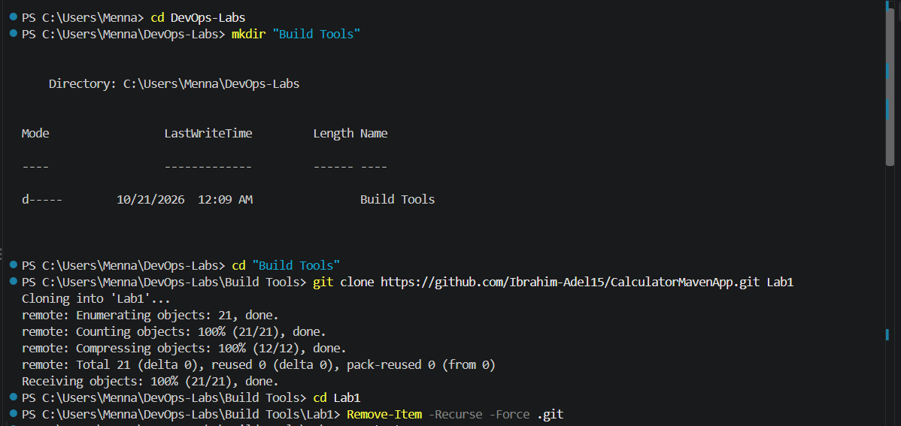
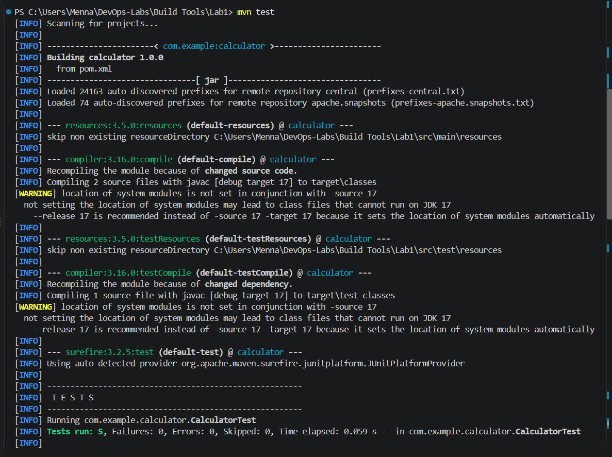
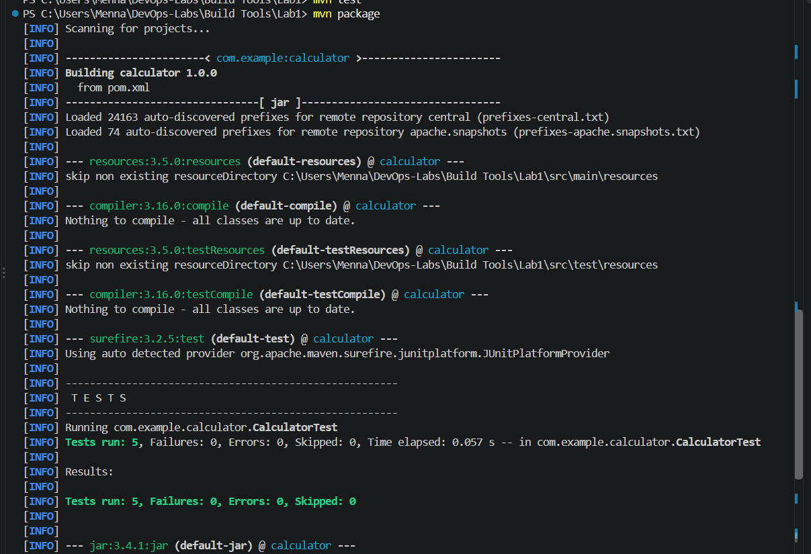
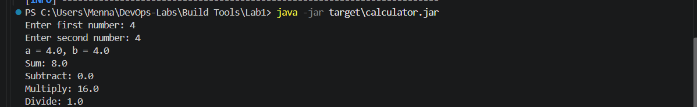

# Lab 1: Building and Packaging a Java Application with Maven

## Objective

Build, test, and package a Java calculator application using **Apache Maven**, then run the generated JAR file.

## Source Code

Repository: https://github.com/Ibrahim-Adel15/CalculatorMavenApp.git

## Prerequisites

- Java JDK 17
- Apache Maven
- Git

Verify the installation:

```powershell
java -version
mvn -version
git --version
```

## Steps

### 1. Clone the source code

```powershell
git clone https://github.com/Ibrahim-Adel15/CalculatorMavenApp.git Lab1
cd Lab1
```

### 2. Run the unit tests

```powershell
mvn test
```

Expected result: all tests pass and the build ends with `BUILD SUCCESS`.

### 3. Build the application

```powershell
mvn package
```

This compiles the code, runs the tests, and generates the artifact:

```
target/calculator.jar
```

### 4. Run the application

```powershell
java -jar target\calculator.jar
```

### 5. Verify the application is working

Enter two numbers when prompted and check the results:

```
Enter first number: 4
Enter second number: 4
a = 4.0, b = 4.0
Sum: 8.0
Subtract: 0.0
Multiply: 16.0
Divide: 1.0
```

## Screenshots

### Clone



### Unit tests



### Build



### Running the application



## Summary

- Run unit tests: `mvn test`
- Build and package: `mvn package`
- Run the application: `java -jar target\calculator.jar`