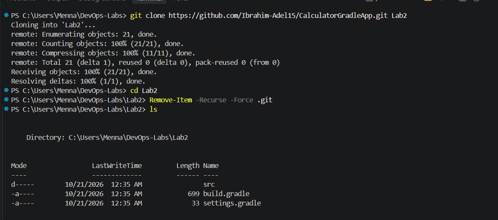
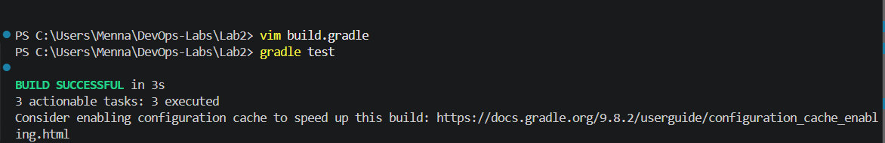
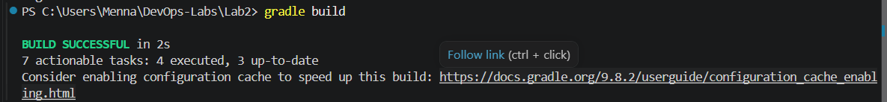
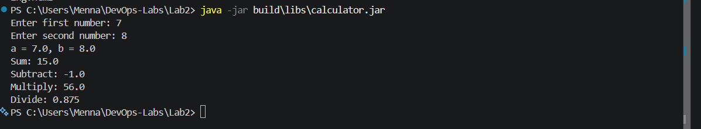

# Lab 2: Building and Packaging a Java Application with Gradle

## Objective

Build, test, and package a Java calculator application using **Gradle**, then run the generated JAR file.

## Source Code

Repository: https://github.com/Ibrahim-Adel15/CalculatorGradleApp.git

## Prerequisites

- Java JDK
- Gradle
- Git

Verify the installation:

```powershell
java -version
gradle -v
git --version
```

## Steps

### 1. Clone the source code

```powershell
git clone https://github.com/Ibrahim-Adel15/CalculatorGradleApp.git Lab2
cd Lab2
```

### 2. Configure the Java version in `build.gradle`

The project requests a specific Java version through a Gradle **toolchain**. On my machine JDK 21 is installed, so running `gradle test` with the default configuration failed with:

```
Cannot find a Java installation on your machine matching: {languageVersion=17 ...}
Toolchain download repositories have not been configured.
```

Fix: open `build.gradle` and change the Java language version to the installed JDK version (21):

```groovy
java {
    toolchain {
        languageVersion = JavaLanguageVersion.of(21)
    }
}
```

> The number must match the version shown by `java -version`. Alternatively, install JDK 17 and keep the original value.

### 3. Run the unit tests

```powershell
gradle test
```

Expected result: `BUILD SUCCESSFUL`.

### 4. Build the application

```powershell
gradle build
```

The artifact is generated at:

```
build/libs/calculator.jar
```

### 5. Run the application

```powershell
java -jar build\libs\calculator.jar
```

### 6. Verify the application is working

Enter two numbers when prompted and check that the results are correct.

> If you get `no main manifest attribute, in calculator.jar`, add the main class to `build.gradle` and rebuild:
>
> ```groovy
> jar {
>     manifest {
>         attributes 'Main-Class': 'com.example.calculator.Main'
>     }
> }
> ```

## Screenshots

### Clone



### Unit tests



### Build



### Running the application



## Summary

- Run unit tests: `gradle test`
- Build and package: `gradle build`
- Run the application: `java -jar build\libs\calculator.jar`
- If the toolchain version is not found, set `JavaLanguageVersion.of(...)` in `build.gradle` to the installed JDK version.