# Lab 7: Multi-Network Microservices, Volumes, and Bind Mounts

In this lab I containerized a three-service Flask application (frontend, backend, and notification) and connected the services through two isolated Docker bridge networks. Logs are persisted with named volumes, and the backend data is persisted on the host with a bind mount.

Application source: https://github.com/Ibrahim-Adel15/MicroserviceApp.git

## How it works

The browser talks to the **frontend**, the frontend talks to the **backend**, and the backend talks to the **notification** service. Each hop lives on its own network, so the frontend can never reach the notification service directly. The backend is the only container attached to both networks.

- `frontend-backend` (`172.20.0.0/24`) connects the frontend and the backend.
- `backend-notification` (`172.21.0.0/24`) connects the backend and the notification service.

## What was created

| Resource | Name |
|----------|------|
| Images | `frontend-image`, `backend-image`, `notification-image` |
| Containers | `frontend`, `backend`, `notification` |
| Networks | `frontend-backend`, `backend-notification` |
| Volumes | `backend-logs`, `notification-logs` |
| Bind mount | host folder `backend-data` mapped to `/app/data` in the backend |

The services listen on ports `3000` (frontend), `5000` (backend), and `5001` (notification). The frontend is published on host port `8080`.

---

## Step 1: Clone the application

```powershell
git clone https://github.com/Ibrahim-Adel15/MicroserviceApp.git
cd MicroserviceApp
```

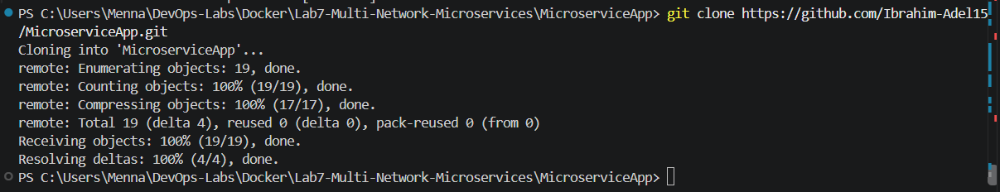

## Step 2: Build the images

Each service folder already contains a `Dockerfile` based on `python:3.12-slim`. I built one image per service from inside its folder.

```powershell
cd backend
docker build -t backend-image .
cd ..\frontend
docker build -t frontend-image .
cd ..\notification
docker build -t notification-image .
cd ..
```

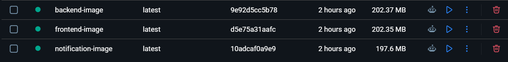

## Step 3: Create the networks

Two bridge networks with separate subnets:

```powershell
docker network create --driver bridge --subnet 172.20.0.0/24 frontend-backend
docker network create --driver bridge --subnet 172.21.0.0/24 backend-notification
```

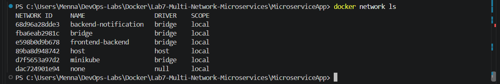

## Step 4: Create the volumes and the host directory

The two named volumes store the backend and notification logs. The `backend-data` folder on the host stores the backend's `messages.json`.

```powershell
docker volume create backend-logs
docker volume create notification-logs
mkdir backend-data
```

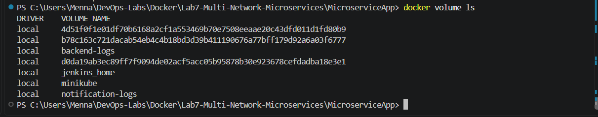

## Step 5: Run the notification container

It runs only on `backend-notification` and writes its logs to the `notification-logs` volume.

```powershell
docker run -d --name notification `
  --network backend-notification `
  -v notification-logs:/app/logs `
  notification-image:latest
```

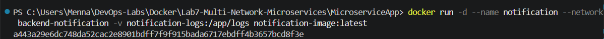

## Step 6: Run the backend container

`docker run` accepts only one `--network`, so the backend starts on `backend-notification` and is then attached to `frontend-backend` with `docker network connect`. It receives the notification URL through an environment variable, uses the `backend-logs` volume for logs, and bind-mounts `backend-data` to `/app/data`.

```powershell
docker run -d --name backend `
  --network backend-notification `
  -e NOTIFICATION_URL=http://notification:5001/notify `
  -v backend-logs:/app/logs `
  -v "${PWD}\backend-data:/app/data" `
  backend-image:latest

docker network connect frontend-backend backend
```

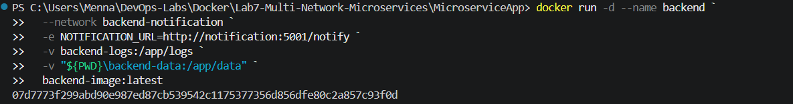

## Step 7: Run the frontend container

The frontend runs on `frontend-backend`, receives the backend URL, and publishes port `8080` on the host (mapped to port `3000` inside the container).

```powershell
docker run -d --name frontend `
  --network frontend-backend `
  -p 8080:3000 `
  -e BACKEND_URL=http://backend:5000 `
  frontend-image:latest
```

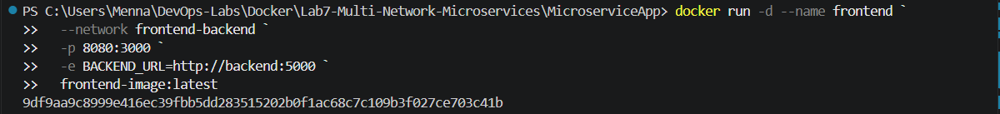

## Step 8: Check that everything is running

```powershell
docker ps
```

All three containers are up, and the frontend shows `0.0.0.0:8080->3000/tcp`.

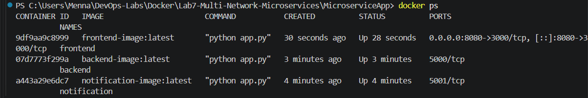

---

## Verification

### The web page

I opened http://localhost:8080, created a message, and confirmed it appears in the list after submitting and after refreshing.

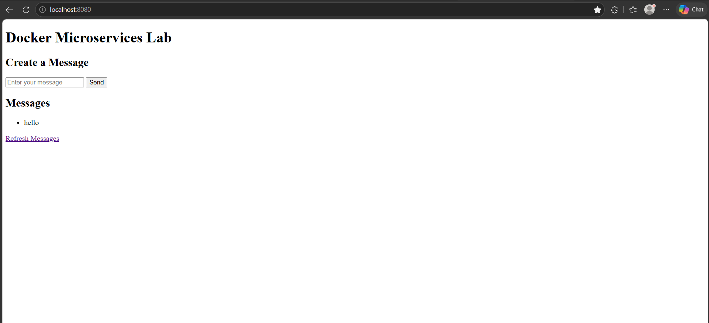

### Data saved on the host (bind mount)

```powershell
type .\backend-data\messages.json
```

The message I created is stored in the host folder:

```json
[
  "hello"
]
```

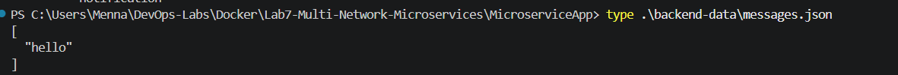

### Backend logs (volume)

```powershell
docker exec backend cat /app/logs/backend.log
```

The log shows the message being created, the notification being sent successfully, and the frontend's `GET` and `POST` requests coming from `172.20.0.3`.

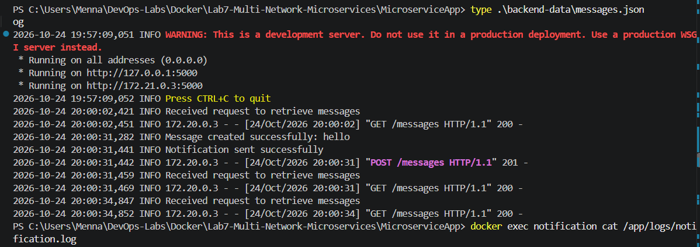

### Notification logs (volume)

```powershell
docker exec notification cat /app/logs/notification.log
```

The notification service received the message from the backend (`172.21.0.3`).

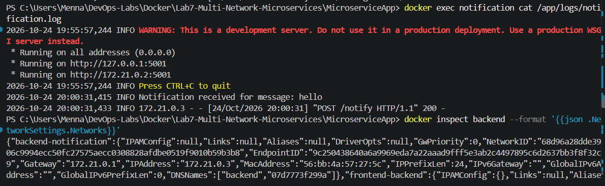

### The backend is on both networks

```powershell
docker inspect backend --format '{{json .NetworkSettings.Networks}}'
```

The backend has `172.21.0.3` on `backend-notification` and `172.20.0.2` on `frontend-backend`.

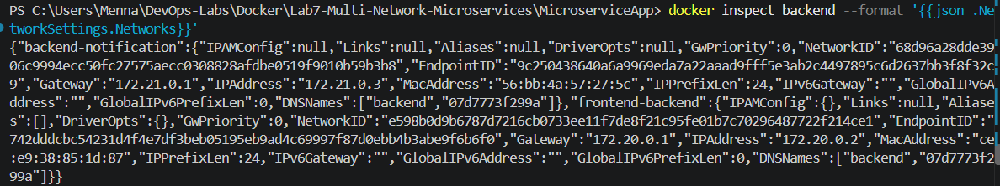

### Network isolation

The frontend should not be able to reach the notification service, because they do not share a network:

```powershell
docker exec frontend python -c "import urllib.request; urllib.request.urlopen('http://notification:5001/health')"
```

The request fails with `No address associated with hostname`, which confirms the isolation.

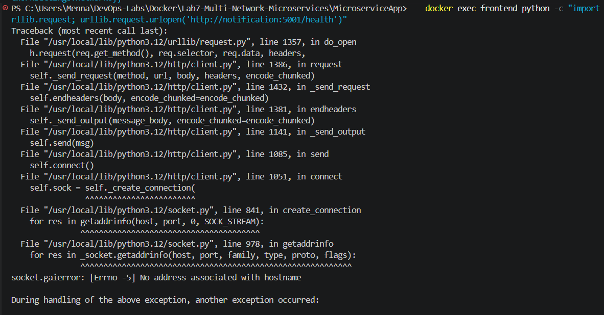

---

## Cleanup

```powershell
docker rm -f frontend backend notification
docker network rm frontend-backend backend-notification
docker volume rm backend-logs notification-logs
```

The `backend-data` folder lives on the host, so it has to be deleted manually if it is no longer needed.

## What I learned

- Custom bridge networks isolate services, and Docker's built-in DNS lets containers reach each other by name (`backend`, `notification`).
- A container can be attached to more than one network, either at start or later with `docker network connect`.
- Named volumes are managed by Docker and keep logs after a container is removed.
- A bind mount maps a host folder into a container, which makes the application data easy to inspect and keep on the host.